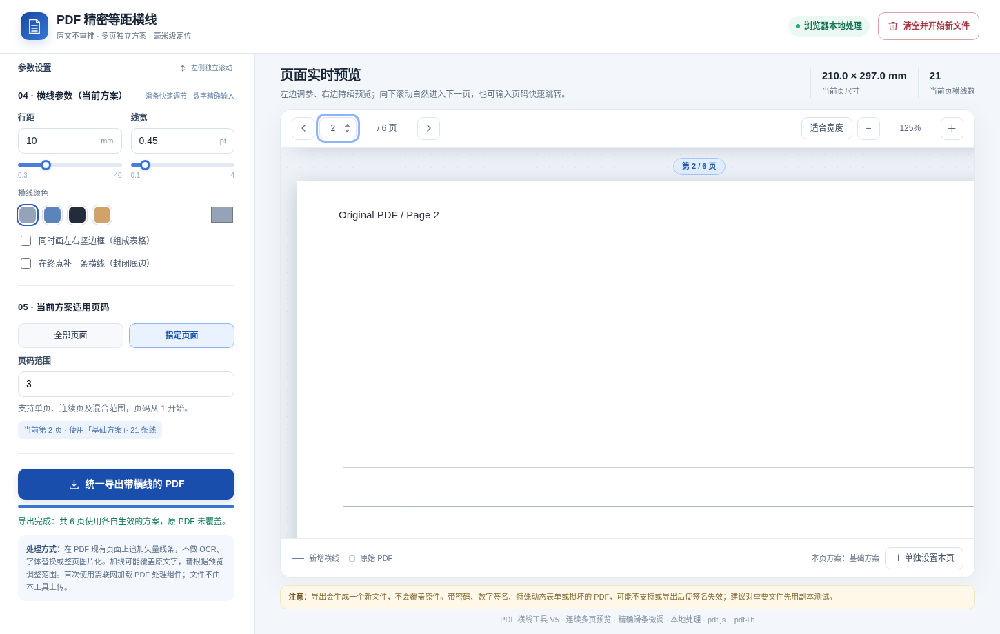

# PDF 精密等距横线工具

在**现有 PDF 上精确添加横线或简易表格**的浏览器工具。适合制作作业答题区、实验记录区、笔记横线纸等；可以为不同页面配置不同的行距、边距与样式，预览后一次性导出。

工具直接在原 PDF 页面上追加矢量线条，**不执行 OCR，也不把原文重新识别、重新排版**。但导出会重新保存 PDF 文件，不保证底层文件结构完全不变。



## 功能概览

- **精确范围**：左、右边距分别设置；顶部起点与底部终点独立设置，横线不会无限延伸到页底。
- **滑条 + 数字输入**：距离、行距以毫米（mm）为单位，线宽以磅（pt）为单位；数值与滑条实时同步。
- **多页面方案**：每套方案独立指定页码、范围和样式。支持复制、暂停、删除及优先级调整，最终统一导出。
- **连续实时预览**：左侧参数区和右侧 PDF 预览区独立滚动；右侧上下滚动自然切换页面，支持缩放和页码跳转。
- **表格边框**：可额外绘制左右竖线及终点处的封闭底线。
- **本地处理**：PDF 文件由浏览器读取和处理，无需上传到项目服务器；导出新文件，不覆盖原件。

## 快速开始

**环境**：推荐使用最新版 Chrome、Edge 或 Safari；支持现代桌面浏览器。不需要安装 Python、Node.js、插件或数据库。页面运行时需联网加载 PDF.js 与 pdf-lib（通过 CDN）。

1. 下载仓库中的 [`index.html`](./index.html)，双击用浏览器打开；也可通过 GitHub Pages 访问部署后的页面。
2. 等待左下角状态显示 **「组件加载完成，可以选择 PDF」**，在 **「01 · 选择原始 PDF」** 中点击选择，或直接拖入 `.pdf` 文件。
3. 导入成功后，会显示文件名、总页数；右侧出现原 PDF 的连续页面预览。
4. 在左侧 **「03 · 四边范围」** 和 **「04 · 横线参数」** 调整位置、行距、线宽及颜色；右侧立即更新横线效果。
5. 在 **「05 · 当前方案适用页码」** 选择全部或指定页面。需要不同页面使用不同设置时，按下文创建多套方案。
6. 检查右侧预览，点击左侧底部 **「导出带横线的 PDF」**。浏览器下载新文件：`原文件名_多方案等距横线.pdf`。

> 成功标志：页面状态显示「导出完成」，浏览器下载列表出现新 PDF。原始文件不会被覆盖。处理下一份文件时，点击右上角 **「清空并开始新文件」** 并确认，即可重置所有方案和预览。

## 参数怎么调

### 1. 四边范围：确定横线出现的位置

所有距离均以**当前 PDF 页面的实际尺寸**为基准，单位为 `mm`。页面左上角是界面中的测量起点。

| 参数 | 含义 | A4 示例 |
| --- | --- | ---: |
| 左边距 | 横线左端距页面左边的距离 | `18 mm` |
| 右边距 | 横线右端距页面右边的距离，可以不同于左边距 | `10 mm` |
| 起点 | 第一条横线距页面顶部的距离 | `75 mm` |
| 终点 | 允许画线的最下边界，由下面的参照方式决定 | `25 mm` |
| 终点参照方式 | **距底部**：预留多少下边距；**距顶部**：终点距顶部的绝对位置 | `距底部` |

以上示例在 A4（210 × 297 mm）上形成：横向 `18–200 mm`、纵向 `75–272 mm` 的画线区域。切换终点参照方式时，工具会尝试换算当前页的终点数值，使终点位置保持不变。

**重要**：上、下边界只控制可以画线的区域，不会删除或自动避让原有文字。若线条覆盖原文，请手动缩小范围。

### 2. 横线样式：决定怎么画

| 控件 | 作用 | 初始值 |
| --- | --- | ---: |
| 行距 | 相邻两条横线的距离 | `9 mm` |
| 线宽 | 横线粗细（注意单位为 `pt`，不是 mm） | `0.45 pt` |
| 横线颜色 | 浅灰、淡蓝、深灰、米黄或自定义颜色 | 浅灰 |
| 同时画左右竖边框 | 在设置的左右边界绘制两条竖线 | 关闭 |
| 在终点补一条横线 | 在指定的终点位置额外绘制底边 | 关闭 |

拖动横向滑条可快速调整，旁边的数字框可精确输入小数。边距与起止位置的滑条范围会随当前页尺寸以及其他边界变化。点击 **「恢复默认」** 只重置**当前选中方案的画线参数**，不会清空整个 PDF 工作区。

**线条计算规则**：第一条线画在「起点」，之后每隔一个「行距」画一条，直到下一条会超过「终点」为止。如果最后一条没有正好落在终点，勾选「在终点补一条横线」即可封闭底边。单页横线数量在右侧顶部显示。上述 A4 示例若行距为 `9 mm`，实际会生成 **22 条等距横线**（不含额外封闭底线）。

### 3. 不同页面使用不同参数

假设有一份 6 页的 PDF：第 1 页不需要横线，第 2–3 页需要 9 mm 行距，第 4 页需要 12 mm 行距，第 5–6 页需要 8 mm 行距。可以这样设置：

1. 选择默认的 **「基础方案」**，将适用范围改为 **「指定页面」→ `2-3`**，设置行距为 `9 mm`。
2. 点击 **「＋ 添加方案」**，将新方案命名为「第 4 页」，输入页码 `4`，设置行距 `12 mm`。
3. 再点一次 **「＋ 添加方案」**，命名为「第 5–6 页」，输入 `5-6`，设置行距 `8 mm`。
4. 在右侧滚动检查第 2、4、5 页的实际效果。第 1 页未命中任何启用的方案，因此保持原样。
5. 点击 **「导出带横线的 PDF」**，所有页面按各自生效的方案一次生成。

页码支持 `1`、`2-5`、`1,3-5,8` 等写法（从 **1** 开始计数）。也可以先在右侧滚动到某一页，再点预览区底部 **「＋ 单独设置本页」**：它会以当前选中方案的参数为基础，新建只作用于当前页的方案。

**方案列表的操作与优先级**：

- 点击方案名称：**选中并编辑**该方案；修改会即时保存到该方案。
- **复制当前方案**：复制参数**以及原有的适用页码**；请按需要修改范围，避免覆盖其他页面。
- **↑ / ↓**：调整方案顺序；**列表越靠下，优先级越高**。若同一页匹配多套方案，只有最下面的启用方案会生效，**不会叠加多套横线**。
- **◉ / ○**：暂停或重新启用方案；暂停方案不参与导出。**删除当前方案**可移除它，但至少保留一套方案。

注意区分「当前正在编辑的方案」和「右侧当前页实际生效的方案」：若当前页被后面的方案覆盖，右侧会显示后者的最终效果；可查看预览底部的「本页方案」提示。**方案仅保存在当前网页内存中**，刷新或关闭页面后不会保留，重要文件请先完成导出。

### 4. 右侧连续预览与重置

- 在**右侧预览区**向下滚动可依次查看后续页面，页码会自动更新；左侧不会跟着滚动。
- 使用顶部 **上一页 / 下一页**、**页码输入框**直接定位；使用 **适合宽度 / − / ＋** 控制缩放。
- 右上角 **「清空并开始新文件」**：确认后清除当前文件、所有方案、预览和参数，恢复初始状态。已下载的 PDF 与电脑上的原文件不受影响。

## 常见问题

| 现象 | 检查方法 |
| --- | --- |
| 停在「正在加载 PDF 处理组件」或提示组件加载失败 | 确认联网；检查 CDN 是否被代理、扩展或网络策略拦截，然后刷新页面。 |
| 导入 PDF 失败 | 检查是否为损坏、加密或不兼容的 PDF；优先用普通 PDF 测试。 |
| 某一页没画线 | 查看该页是否命中启用方案，以及是否被列表靠下的方案覆盖。 |
| 提示页码范围错误 | 页码从 1 开始，不能超过总页数；范围如 `3-5` 不能写反。 |
| 提示起点/终点或边距无效 | 左右边距之和必须小于页面宽度；终点必须在起点下方，不能越界。 |
| 行距过小或导出失败 | 行距至少 `0.3 mm`；单页最多生成 `3000` 条横线。 |
| 横线压住原文字 | 缩小画线范围或修改对应页面的专用方案；工具不会自动识别正文避让。 |
| 签名、表单等内容异常 | 重新保存可能使数字签名失效，某些动态表单或特殊 PDF 可能不兼容；使用原文件的副本测试。 |

## 开发说明

### 项目结构与技术栈

```text
.
├── index.html          # 页面、样式和全部交互 / PDF 处理逻辑
├── README.md           # 使用与开发说明
└── assets/
    └── preview.png     # 浏览器测试界面截图
```

项目是一个**单文件静态 Web 应用**，不需要打包器或后端。主要使用：

| 技术 | 版本 / API | 在项目中的职责 |
| --- | --- | --- |
| HTML / CSS | 原生 Web | 表单、双栏独立滚动、响应式布局、滑条与连续页面容器 |
| JavaScript | 原生 ES6+ | 方案状态、参数校验、页面事件及导出控制 |
| [PDF.js](https://mozilla.github.io/pdf.js/) | `3.11.174` | 读取 PDF 页面、获取尺寸、渲染预览、转换页面坐标 |
| [pdf-lib](https://pdf-lib.js.org/) | `1.17.1` | 载入原始 PDF 字节、追加矢量线条并保存新文件 |
| Canvas 2D | 浏览器 API | 将预览中的新增线条绘制到透明叠加画布 |
| IntersectionObserver | 浏览器 API | 只渲染临近可视区域的 PDF 页面，离开视野后释放画布任务 |

`initialize()` 通过 `loadScript()` 从 cdnjs 加载两套 PDF 库，失败时依次尝试 jsDelivr、unpkg；PDF.js 的 Worker 文件路径根据实际加载源设置。**PDF 内容本身不会通过项目代码发送至服务器**，但页面会请求这些第三方 CDN 的脚本资源。

### 核心执行流程

```text
用户选择 PDF
  → readFile()：读取 ArrayBuffer，交给 PDF.js 解析
  → buildPreview()：建立连续页占位与可视区域监听
  → renderSlot()：渲染原页；paintSlot()：透明画布上预览横线
  → 编辑方案：saveFormToRule() + resolveRules() + geometry()
  → exportPdf()：逐页验证 → pdf-lib 写入矢量线 → 下载新 PDF
```

**关键函数速查（均在 `index.html` 的内联脚本中）**：

| 函数 | 作用与维护要点 |
| --- | --- |
| `makeRule()` / `loadRuleToForm()` / `saveFormToRule()` | 创建方案、在表单与方案状态之间同步数据；方案包含 `name`、`scope`、`range`、`enabled`、`config` 等字段。 |
| `getPageSet()` | 将 `1,3-5,8` 解析成页码集合，并验证页码边界和范围顺序。 |
| `resolveRules()` | 按方案列表顺序写入 `Map<页码, 方案>`，后写入者覆盖前者；同时统计重叠页。 |
| `geometry()` | 校验边距、起止位置、行距、线宽，计算实际画线边界与横线条数。 |
| `updateSliders()` | 根据当前页尺寸和已有边界动态计算滑条范围，并同步数字输入框。 |
| `buildPreview()` / `renderSlot()` / `releaseSlot()` | 建立多页视图，按需创建及回收预览 Canvas，避免所有页面始终占用渲染内存。 |
| `paintSlot()` / `paintLines()` | 在独立透明 Canvas 上绘制预览线条，不修改原 PDF 预览底图。 |
| `trackCurrentPage()` / `goToPage()` | 滚动时识别当前页，以及通过页码定位到指定页。 |
| `exportPdf()` | 汇总各页生效方案、逐页验证、调用 pdf-lib `drawLine()`、`save()` 并触发浏览器下载。 |
| `clearAllData()` | 重置文件、方案、预览及控件，保留已加载的 JS 库供下一份文件使用。 |

### 两个关键实现细节

**① 页面优先级不是「叠加所有方案」**。`resolveRules()` 按列表顺序逐一覆盖页码映射，因此每个被选中的 PDF 页面只对应**一套最终方案**；未命中的页面不加线。这也使「全部页面基础方案 + 少数页面专用方案」成为可能。

**② 预览坐标与 PDF 坐标不相同**。界面中的距离以 mm 计算，而 PDF 使用 pt：

```js
const PT_PER_MM = 72 / 25.4;
const finish = cfg.endMode === 'bottom' ? pageHeightMm - cfg.end : cfg.end;
const count = Math.floor((finish - cfg.top + 1e-7) / cfg.spacing) + 1;
```

实际代码由 `geometry()` 完成毫米到 PDF 尺寸的换算；导出时通过 PDF.js 的 `viewport.convertToPdfPoint(x, y)` 将页面预览坐标映射到 PDF 坐标，再交给 pdf-lib 的 `dest.drawLine()`。不需要把整页 PDF 转成图片，因此原有文字不会因为重新排版而变化；但 **pdf-lib 会重新序列化 PDF**，不承诺文件内部对象或数字签名保持原状。

此外，预览使用 **两层 Canvas**（原始页面 + 透明横线层），调参仅重绘横线层；`IntersectionObserver` 负责页面按需渲染；`previewGeneration` / `importGeneration` 防止切换文件或清空后旧异步结果重新写入界面。项目当前仓库未附独立自动化测试套件。

### GitHub Pages 部署

1. 将 `index.html`、`README.md` 和 `assets/preview.png` 放在 GitHub 仓库的对应目录。
2. 进入仓库 **Settings → Pages**。
3. 在 **Build and deployment** 中选择 **Deploy from a branch**；分支选 `main`，文件夹选 `/(root)` 并保存。
4. 等待 GitHub Pages 发布后，在仓库 Pages 页面查看访问地址。之后更新 `main` 分支中的 `index.html` 即可更新网站。

静态部署不需要构建命令；GitHub Pages 只提供 HTML 等静态文件，PDF 在访问者的浏览器内处理。第三方库 CDN 不可用时，预览和导出也将无法初始化。

## License

本项目代码仅供学习、研究与个人使用。未经作者许可，禁止将本项目用于商业用途、直接复制后重新发布，或以本项目及其衍生代码作为独立项目进行再发布。

第三方依赖分别遵循其自身许可证；仓库公开可见不等于获得上述限制之外的使用许可。
